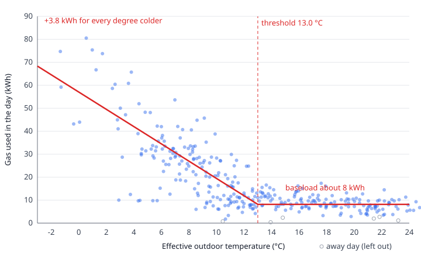

# How the heating model works

This is a plain-language guide to the heating model: what it learns from our gas and weather history, how it judges each day, and what it can and cannot tell you. You do not need any statistics. Where an idea has a proper name, there is a "learn more" link.

All the real numbers below come from this household's own data, up to 12 October 2026. They will drift as new data arrives.

> **Status.** The maths described here is built and tested. The daily job that runs it, the seven-day projection, the weekly chart and the dashboard panels that show it are still being built, so a few things below (the range around the threshold in section 4, which sections 7 and 8 use for borderline days, the estimated/confirmed label in section 10, the chart notes in 10b, the projection in section 11 and the panels in section 12) do not appear anywhere yet. They are written as they will work.

## 1. What this is for, and the picture

The question is simple: **on which days did we need the heating, and on which days did we use more gas than the weather justified?**

Plot every day as a dot, with the outdoor temperature across the bottom and the gas used up the side, and the dots make a shape like a hockey stick. On warm days the dots sit on a flat line: the gas that is used whatever the weather (hot water and cooking). As the days get colder than a certain point, the dots climb steadily, because the heating is doing more work.

*Each dot is one day in the 12 months to 12 October 2026. The red line is the fitted model, drawn with the newest baseload; each real day had its own baseload, which is part of why the dots scatter. The hollow dots are away days, left out of the fit.*

The model draws that hockey stick through our own dots, then asks of each day: is this dot where the weather says it should be, or well above?

## 2. The one-line idea

On any day, gas used is roughly **a baseload that is always there, plus a slope's worth of extra for every degree the day was colder than a threshold**.

That is the only formula in this guide (later sections repeat it in words). In words: take the temperature below which heating starts, see how far under it the day was, multiply by how much gas each of those degrees costs, and add the always-there gas on top. Everything else is detail on one of those four pieces (baseload, threshold, slope, "how cold the day was").

This family of models is old and well tested. Building scientists have used it since the 1980s to read heating use from utility bills ([the original method, PRISM](https://www.aceee.org/wp-content/uploads/proceedings-1980-2020/1986/SS86_Panel9_Paper_04.pdf)). It is a kind of [segmented regression](https://en.wikipedia.org/wiki/Segmented_regression): a straight line fitted in pieces, with a bend where one piece meets the next. If "regression" is new to you, [linear regression](https://en.wikipedia.org/wiki/Linear_regression) is the gentlest place to start.

## 3. Baseload, and why it moves

The **baseload** is the gas we use on a day warm enough that the heating is off: the hot water and the cooker. On a warm day it is nearly all the gas there is.

The model measures it from the warm days themselves. It averages the gas on warm days over the last 120 days. A "warm day" here means at least a degree above the threshold, and it needs at least eight such days in the window before it will trust the answer.

The baseload is **not a fixed number**, and that matters. In our data it was about 6.1 kWh a day in mid-June 2025 and about 9.2 kWh a day in mid-June 2026. Something in the household changed between the two summers (perhaps more hot water, or a different routine), and a fixed baseload would have blamed the heating for it.

In the depths of winter there are not eight warm days in a 120-day window, so the model cannot measure the baseload then. It joins the last measured value to the next one with a straight line (labelled "interpolated") and, for the newest days, holds the last measured value (labelled "held"). Days before the first measured value hold that first value. Every day therefore has a baseload, and every baseload says how it was obtained: measured, interpolated or held.

## 4. The threshold

The **threshold** is the outdoor temperature below which the heating starts to be needed. Above it, extra cold makes no difference to gas; below it, every degree matters.

The model finds it by trying every value from 8 to 18 °C in steps of a tenth of a degree and keeping the one whose line fits our dots best. On our latest data the answer is **13.0 °C**.

That is higher than many people expect (heating is often said to start around 15.5 °C). It is the number our own house tells us, which is the point: you can use it for a rule such as "no heating on days warmer than 13".

Because it is found from noisy data, the model will also work out a range around it, by re-running the fit many times on randomly reshuffled copies of our days. A threshold of 13.0 with a range of a degree either way is a very different claim from 13.0 with a range of five degrees. See [bootstrapping](https://en.wikipedia.org/wiki/Bootstrapping_%28statistics%29) and [confidence interval](https://en.wikipedia.org/wiki/Confidence_interval) for the idea.

The measure of "degrees colder than the threshold" has a name: [heating degree days](https://en.wikipedia.org/wiki/Heating_degree_day). A day that averages 3 °C against a 13 °C threshold is 10 degree-days.

## 5. The slope

The **slope** is how much extra gas each degree-day costs. On our latest data it is **about 3.8 kWh per degree-day**. A day 10 degrees under the threshold needs about 38 kWh of heating gas on top of the baseload.

The slope is found by the standard method of drawing the straight line that sits closest to all the dots at once, called [ordinary least squares](https://en.wikipedia.org/wiki/Ordinary_least_squares). It also gives a single score for how well the whole shape fits, called [R-squared](https://en.wikipedia.org/wiki/Coefficient_of_determination). Ours is about **0.69**, meaning temperature explains about 69% of the day-to-day ups and downs in our gas. The other 31% is everything else: sun, wind, how many people were home, how long the shower ran.

## 6. Why yesterday matters

A house is a big lump of brick that heats up and cools down slowly (this is called [thermal mass](https://en.wikipedia.org/wiki/Thermal_mass)). A cold snap that arrived yesterday is still pulling heat out of the walls today. So the model does not use today's temperature on its own. It uses a blend of today's and yesterday's average temperature, which it calls the **effective temperature**.

How much of yesterday goes into the blend is itself learned from the data, within a limit of 80%. On our latest data the best blend is at that limit: about four-fifths yesterday, one-fifth today. That is worth keeping an eye on. If the best answer keeps landing on the limit, it is telling us the house has a longer memory than a two-day blend can express.

The temperatures themselves come from a weather service that publishes an hourly reading for our area: live readings where we have them, and otherwise its archive, which is [reanalysis data](https://en.wikipedia.org/wiki/Reanalysis) (measurements and models blended into a complete record). A day's average is only used when all of its hours are present. A day with a gap is left out, never averaged from what is left.

## 7. Judging a day

Once the line is drawn, each day is judged using four ideas (the baseload from section 3 completes the picture):

1. **Expected gas**: the baseload plus the slope times the degree-days. Where the line says that day's dot should be.
2. **Normal wobble**: how far a dot can stray from the line on an ordinary day without anything being wrong. People are not machines, and the difference between the line and the dot (called the [residual](https://en.wikipedia.org/wiki/Errors_and_residuals)) is never zero.
3. **Possible**: gas beyond the normal wobble, but not by much.
4. **Clear**: gas well beyond the normal wobble.

The wobble is measured as a [standard deviation](https://en.wikipedia.org/wiki/Standard_deviation): a yardstick for how far a typical day strays. "Possible" is between one and two yardsticks above the line; "clear" is beyond two. The first yardstick of overshoot is always counted as normal wobble.

The yardstick **grows with the cold**. On a warm day the yardstick is about 3 to 3.5 kWh. On a bitterly cold day it is 15 to 21 kWh, so a dot can sit that far from the line and still be ordinary, because there is far more heating going on to vary. Statisticians call this unequal spread [heteroscedasticity](https://en.wikipedia.org/wiki/Heteroscedasticity); in practice it means the model is lenient on cold days and strict on warm ones, as it should be.

Every day's gas splits exactly into five slices that add up to the day's actual gas: **baseload**, **expected heating**, **normal wobble**, **possible**, **clear**. A day that used less than expected has a negative wobble slice, and its possible and clear slices are zero.

### A worked example: a cold day

Friday 9 January 2026, with the model as fitted in October 2026.

- Outdoor average that day: **3.32 °C**, and 3.94 °C the day before. With about four-fifths of the blend from yesterday, the effective temperature is **3.82 °C**.
- That is 9.18 degrees under the 13.0 °C threshold.
- Expected heating: 9.18 degree-days × 3.76 kWh = **34.52 kWh**. The baseload that day was **6.89 kWh**. So the model expected **41.41 kWh**.
- The wobble yardstick at 9.18 degree-days is **14.86 kWh**.
- Actual gas: **65.73 kWh**. That is 24.32 kWh over expected.
- Slices: 6.89 baseload + 34.52 expected heating + 14.86 normal wobble + **9.46 possible** + 0 clear = 65.73.

So the first 14.86 kWh of overshoot is written off as normal wobble. The next 9.46 kWh is flagged as "possible". It was not enough to count as "clear" (that would need more than 29.72 kWh over expected). It was a cold day, so the heating was needed. The 9.46 kWh is **excess** on a needed day, not an avoidable one.

### A worked example: a warm day

Saturday 26 September 2026.

- Outdoor average 16.03 °C, 18.00 °C the day before. The effective temperature is 17.60 °C (from the unrounded temperatures), comfortably above the threshold. No heating was needed.
- Baseload 8.34 kWh, expected heating 0, wobble yardstick 3.42 kWh.
- Actual gas: **17.34 kWh**.
- Slices: 8.34 baseload + 0 heating + 3.42 normal wobble + **3.42 possible** + **2.16 clear** = 17.34.

No heating was needed, and gas was 9.00 kWh over baseload. After setting aside the first 3.42 kWh as wobble, the remaining 5.58 kWh is **avoidable** gas, with 2.16 kWh of it beyond two yardsticks, so "clear". The model cannot say why: the heating may have been on, or a lot of hot water used, on a warm Saturday.

### Needed, and not needed

A day is **needed** if its effective temperature is below the top of the threshold's range, and **not needed** otherwise. The top of the range is used rather than the best-fit threshold on purpose: a day sitting right at the threshold is a borderline call, and the model gives the benefit of the doubt. Any overshoot on a needed day is called excess; on a not-needed day it is called avoidable.

Over the 12 months to 12 October 2026, 58 of the 333 days judged (away days are not judged, so they are not in the 333) had some gas beyond the normal wobble: 43 whose worst level was "possible" and 15 that reached "clear" (about 17% in all). The "clear" level is set at two yardsticks. A textbook bell curve would put only about 2% of days that far over, but our gas runs high more often than it runs low (the technical word is [skewed](https://en.wikipedia.org/wiki/Skewness)), and 15 of the 333 days (4.5%) reached "clear". If "clear" feels too common, that is the setting to raise.

## 8. Why the totals are a floor

When the dashboard adds up "possible" and "clear" gas over a month or a year, it is giving a **floor**, a figure that is at least this much and probably more. Every choice the model makes leans the same way:

- Only the part **beyond** the wobble counts. The wobble itself, which includes real overuse that happens to look normal, is never counted as waste.
- Borderline days are treated as needed, so none of their overshoot counts as avoidable.
- The yardstick is the household's **typical** days, not its best. A house that is always a little wasteful has that waste baked into the line, so it does not show up as a verdict.
- Away days (next section) are shown as neutral, and days with missing gas are left out. Neither is counted as savings or waste.

So when a total says "at least 150 kWh avoidable", believe that as a minimum, not as an estimate of the true amount.

## 9. Away days

On a holiday the heating is off and the hot water and cooking stop too. Gas for those days falls far below the baseload. If the model treated them as ordinary warm days it would pull its idea of the baseload down, and then every normal day afterwards would look wasteful.

So after a first fit, any day with gas below about a third of its baseload is marked **away**. It is dropped, and the fit is done a second time without it. Away days are shown as neutral in the verdicts: neither a saving nor waste. In our data 33 days are marked away, 27 of them in one stretch of July and August 2025.

A day with a gas reading of exactly zero is a different thing again. It is a missing reading (the meter data did not arrive), and is treated as missing, not as a day of no use.

## 10. Estimated, or confirmed

The model learns its threshold from gas. There is a second, independent clue: the thermostat itself. Hive records when the heating is calling for heat. If the days on which the thermostat asked for heat for at least half an hour (boost presses do not count) were the colder days, and the other days the warmer ones, with the dividing line at about the same temperature, then two unrelated sources agree and the number is probably real.

A day only counts if the thermostat reported on at least about 90% of it (the readings arrive every two minutes, so about 650 of 720); a day with a long gap in the readings is not classified at all. A model is labelled **confirmed** when the thermostat's threshold is within about 1.5 °C of the gas-based one, with about 15 heating days and 15 non-heating days to judge it on. Otherwise it is labelled **estimated**. Until there is enough thermostat history the label will be **estimated**, and at the moment that history is short. The label does not change how the model works; it tells you how far to trust the threshold.

## 10b. Why some days and weeks are left out

You will see days and weeks missing from some charts. That could look like removing the awkward ones. It is not, and here is why:

- **The rules are about whether a number can be measured, not about what it says.** A week with mostly missing gas readings, a week too mild to have any heating to measure, and a week where the heating was off (so the ratio divides by almost nothing) all give meaningless numbers. The rules look at how complete and how cold the week was, never at whether it flatters the answer.
- **They apply the same to every week and every year.** The week rules are: at least 5 complete gas days, at least 1.5 degree-days a day, and at least 0.5 kWh a day of heating gas above baseload (in both years, when two years are being compared).
- **The same goes for single days.** A day with missing or partial gas, a day with a gap in its hourly weather, a day with too few thermostat readings, and an away day are left out because they cannot be measured or would distort the line, whichever way they would have pointed.
- **The answer survives changing the rules.** When the year-on-year comparison was tried with seven different sets of rules, from none at all to the strictest, the direction of the result never changed.
- **Nothing is hidden.** Left-out weeks will show as gaps, and the chart will say how many were shown and why the others were left out.

There are honest caveats. The exact numbers 1.5 and 0.5 were chosen after looking at one winter's data, and another winter, with the rules unchanged, is the fair test. And the evidence from the weekly comparison on its own is weak: the rules kept 14 of that winter's 28 weeks, and the honest summary of what they showed was "probably somewhat worse than last year, not proven". Guards stop noise being mistaken for a finding; they cannot make weak evidence strong. The full argument is in the [week rules note](../.agent-docs/research/year-on-year-week-rules.md).

## 11. What the model cannot tell you

- **Why.** It can say a day used more than expected. It cannot say whether that was a higher thermostat setting, a boost, a guest, a bath, or a boiler running badly.
- **Heating versus hot water.** It separates them statistically, using warm days to learn the hot-water level. It does not measure either one directly.
- **Weather it does not see.** Wind, sunshine and rain affect a real house, and the model sees only temperature. Cloudy-and-still and sunny-and-gusty days with the same average look identical to it. This is part of the 31% R-squared leaves unexplained.
- **Your house, exactly.** The temperatures are area-wide values for our location, not a thermometer on the wall.
- **The future with certainty.** It will project the next seven days from the weather forecast. A forecast that is two degrees out moves tomorrow's projection by only about 1.5 kWh (four-fifths of the blend is today, which is nearly over, so only a fifth rides on the forecast), but a day later in the week by about 7 to 8 kWh, because then both days in the blend are forecasts.
- **That two years are alike.** Our last two years differ in baseload and in threshold. The model fits the latest 12 months, so it follows the house as it is now, but a sudden change takes weeks to show.

## 12. Reading the dashboard panels

These are the panels the model will feed. They are still being built, so this section describes what to look for.

- **Gas against outdoor temperature, with the fitted bend.** Each dot is a day. The flat part on the right is the baseload; the climbing part on the left is the heating. The legend gives the baseload, the threshold, the slope and the estimated/confirmed label. Dots high above the line are the days to look at.
- **Where the gas went.** A stacked bar for each day, in the five slices from section 7: baseload, expected heating, normal wobble, possible and clear. The bar is the real total, so it always adds up. Look for tall "possible" and "clear" caps on warm days.
- **Heating efficiency by week.** The gas the heating used (above baseload) for every degree-day of cold, this winter against last. Lower is better. A week left out for the reasons in section 10b appears as a gap.
- **Saving from a setpoint 1 °C lower.** The slope multiplied by the number of days heating was needed. With a slope of 3.8 kWh, and roughly 200 days a year that need heating (196 in the last 12 months), that is about **740 kWh** a year. It is an estimate from the model, not a promise.
- **The next seven days.** Expected gas for each day from the forecast temperature, using the same line.

## 13. Glossary and further reading

**Avoidable.** Gas beyond the normal wobble on a day that did not need heating.

**Away day.** A day with gas under about a third of the baseload, treated as a holiday and left out.

**Baseload.** Gas used whatever the weather: hot water and cooking. Measured from warm days over the last 120 days.

**Clear.** Gas more than two yardsticks above expected.

**Degree-day.** One degree of difference below the threshold, for one day. A 3 °C day against a 13 °C threshold is 10 degree-days.

**Effective temperature.** The blend of today's and yesterday's average temperature that the model treats as "how cold it was".

**Estimated, confirmed.** How far to trust the threshold: confirmed only when the thermostat's own behaviour agrees.

**Excess.** Gas beyond the normal wobble on a day that did need heating.

**Expected gas.** The baseload plus the slope times the degree-days.

**Floor.** A total that is at least this much and probably more, because every choice in the model leans towards counting less waste.

**Needed, not needed.** Whether the weather justified heating that day.

**Normal wobble.** Up to one yardstick of difference from expected, counted as ordinary (negative on a day that used less than expected).

**Possible.** Gas between one and two yardsticks above expected.

**Residual.** The difference between a day's actual gas and its expected gas.

**Slope.** The extra gas each degree-day costs, in kWh.

**Threshold.** The temperature below which heating starts to be needed.

**Yardstick (standard deviation).** How far a typical day strays from the line. It grows with the cold.

### Learn more

- [Heating degree day](https://en.wikipedia.org/wiki/Heating_degree_day)
- [Linear regression](https://en.wikipedia.org/wiki/Linear_regression)
- [Ordinary least squares](https://en.wikipedia.org/wiki/Ordinary_least_squares)
- [Segmented regression](https://en.wikipedia.org/wiki/Segmented_regression)
- [Standard deviation](https://en.wikipedia.org/wiki/Standard_deviation)
- [Errors and residuals](https://en.wikipedia.org/wiki/Errors_and_residuals)
- [Heteroscedasticity](https://en.wikipedia.org/wiki/Heteroscedasticity)
- [Skewness](https://en.wikipedia.org/wiki/Skewness)
- [Confidence interval](https://en.wikipedia.org/wiki/Confidence_interval)
- [Bootstrapping](https://en.wikipedia.org/wiki/Bootstrapping_%28statistics%29)
- [Coefficient of determination (R-squared)](https://en.wikipedia.org/wiki/Coefficient_of_determination)
- [Thermal mass](https://en.wikipedia.org/wiki/Thermal_mass)
- [Reanalysis](https://en.wikipedia.org/wiki/Reanalysis)
- [PRISM, the original three-parameter heating model](https://www.aceee.org/wp-content/uploads/proceedings-1980-2020/1986/SS86_Panel9_Paper_04.pdf)
