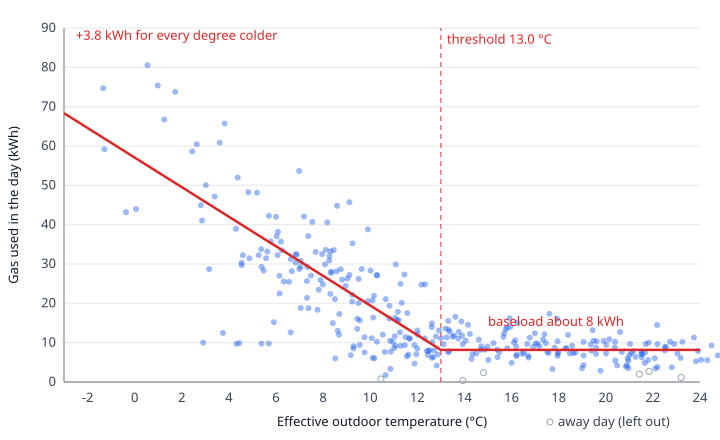

# How the heating model works

This is a plain-language guide to the heating model: what it learns from our gas and weather history, how it projects the gas a day should use, and what it can and cannot tell you. You do not need any statistics. Where an idea has a proper name, there is a "learn more" link.

All the real numbers below come from this household's own data, up to 12 October 2026. They will drift as new data arrives.

> **Status.** The maths described here is built, tested and runs daily. The model is refitted weekly and projects the next seven days, which show as the expected-gas bars on the daily gas panel and drive the cost forecast (section 9). Earlier versions also judged each past day, compared weeks and labelled the model against the thermostat; those were removed on 4 November 2026, after the dashboard review of 2 November took away the panels that showed them (see ADR-0030).

## 1. What this is for, and the picture

The question is simple: **how much gas should a day use, given the weather?**

Plot every day as a dot, with the outdoor temperature across the bottom and the gas used up the side, and the dots make a shape like a hockey stick. On warm days the dots sit on a flat line: the gas that is used whatever the weather (hot water and cooking). As the days get colder than a certain point, the dots climb steadily, because the heating is doing more work.

*Each dot is one day in the 12 months to 12 October 2026. The red line is the fitted model, drawn with the newest baseload; each real day had its own baseload, which is part of why the dots scatter. The hollow dots are away days, left out of the fit.*

The model draws that hockey stick through our own dots. Read off the line, any day's temperature gives the gas we should expect, which is what the seven-day projection uses.

## 2. The one-line idea

On any day, gas used is roughly **a baseload that is always there, plus a slope's worth of extra for every degree the day was colder than a threshold**.

That is the only formula in this guide (later sections repeat it in words). In words: take the temperature below which heating starts, see how far under it the day was, multiply by how much gas each of those degrees costs, and add the always-there gas on top. Everything else is detail on one of those four pieces (baseload, threshold, slope, "how cold the day was").

This family of models is old and well tested. Building scientists have used it since the 1980s to read heating use from utility bills ([the original method, PRISM](https://www.aceee.org/wp-content/uploads/proceedings-1980-2020/1986/SS86_Panel9_Paper_04.pdf)). It is a kind of [segmented regression](https://en.wikipedia.org/wiki/Segmented_regression): a straight line fitted in pieces, with a bend where one piece meets the next. If "regression" is new to you, [linear regression](https://en.wikipedia.org/wiki/Linear_regression) is the gentlest place to start.

## 3. Baseload, and why it moves

The **baseload** is the gas we use on a day warm enough that the heating is off: the hot water and the cooker. On a warm day it is nearly all the gas there is.

The model measures it from the warm days themselves. It averages the gas on warm days over the last 120 days. A "warm day" here means at least a degree above the threshold, and it needs at least eight such days in the window before it will trust the answer.

The baseload is **not a fixed number**, and that matters. In our data it was about 6.1 kWh a day in mid-June 2025 and about 9.2 kWh a day in mid-June 2026. Something in the household changed between the two summers (perhaps more hot water, or a different routine), and a fixed baseload would have blamed the heating for it.

In the depths of winter there are not eight warm days in a 120-day window, so the model cannot measure the baseload then. It joins the last measured value to the next one with a straight line (labelled "interpolated") and, for the newest days, holds the last measured value (labelled "held"). Days before the first measured value hold that first value. Every day therefore has a baseload, and every baseload says how it was obtained: measured, interpolated or held.

## 4. The threshold

The **threshold** is the outdoor temperature below which the heating starts to be needed. Above it, a warmer or colder day makes no difference to gas; below it, every degree matters.

The model finds it by trying every value from 8 to 18 °C in steps of a tenth of a degree and keeping the one whose line fits our dots best. On our latest data the answer is **13.0 °C**.

That is higher than many people expect (heating is often said to start around 15.5 °C). It is the number our own house tells us, which is the point: you can use it for a rule such as "no heating on days warmer than 13".

The measure of "degrees colder than the threshold" has a name: [heating degree days](https://en.wikipedia.org/wiki/Heating_degree_day). A day that averages 3 °C against a 13 °C threshold is 10 degree-days.

## 5. The slope

The **slope** is how much extra gas each degree-day costs. On our latest data it is **about 3.8 kWh per degree-day**. A day 10 degrees under the threshold needs about 38 kWh of heating gas on top of the baseload.

The slope is found by the standard method of drawing the straight line that sits closest to all the dots at once, called [ordinary least squares](https://en.wikipedia.org/wiki/Ordinary_least_squares). It also gives a single score for how well the whole shape fits, called [R-squared](https://en.wikipedia.org/wiki/Coefficient_of_determination). Ours is about **0.69**, meaning temperature explains about 69% of the day-to-day ups and downs in our gas. The other 31% is everything else: sun, wind, how many people were home, how long the shower ran.

## 6. Why yesterday matters

A house is a big lump of brick that heats up and cools down slowly (this is called [thermal mass](https://en.wikipedia.org/wiki/Thermal_mass)). A cold snap that arrived yesterday is still pulling heat out of the walls today. So the model does not use today's temperature on its own. It uses a blend of today's and yesterday's average temperature, which it calls the **effective temperature**.

How much of yesterday goes into the blend is itself learned from the data, within a limit of 80%. On our latest data the best blend is at that limit: about four-fifths yesterday, one-fifth today. That is worth keeping an eye on. If the best answer keeps landing on the limit, it is telling us the house has a longer memory than a two-day blend can express.

The temperatures themselves come from a weather service that publishes an hourly reading for our area: live readings where we have them, and otherwise its archive, which is [reanalysis data](https://en.wikipedia.org/wiki/Reanalysis) (measurements and models blended into a complete record). A day's average is only used when all of its hours are present. A day with a gap is left out, never averaged from what is left.

## 7. Away days

On a holiday the heating is off and the hot water and cooking stop too. Gas for those days falls far below the baseload. If the model treated them as ordinary warm days it would pull its idea of the baseload down, and then every normal day afterwards would look wasteful.

So after a first fit, any day with gas below about a third of its baseload is marked **away**. It is dropped, and the fit is done a second time without it. Across all the history we hold, 33 days are marked away, 27 of them in one stretch of July and August 2025; six fall in the last 12 months and show as hollow dots in the chart in section 1.

A day with a gas reading of exactly zero is a different thing again. It is a missing reading (the meter data did not arrive), and is treated as missing, not as a day of no use.

## 8. What the model cannot tell you

- **Why.** It can say how much gas a day should use. It cannot say why a real day used more or less, whether that was a higher thermostat setting, a boost, a guest, a bath, or a boiler running badly.
- **Heating versus hot water.** It separates them statistically, using warm days to learn the hot-water level. It does not measure either one directly.
- **Weather it does not see.** Wind, sunshine and rain affect a real house, and the model sees only temperature. Cloudy-and-still and sunny-and-gusty days with the same average look identical to it. This is part of the 31% R-squared leaves unexplained.
- **Your house, exactly.** The temperatures are area-wide values for our location, not a thermometer on the wall.
- **The future with certainty.** It projects the next seven days from the weather forecast. A forecast that is two degrees out moves tomorrow's projection by only about 1.5 kWh (four-fifths of the blend is today, which is nearly over, so only a fifth rides on the forecast), but a day later in the week by about 7 to 8 kWh, because then both days in the blend are forecasts.
- **That two years are alike.** Our last two years differ in baseload and in threshold. The model fits the latest 12 months, so it follows the house as it is now, but a sudden change takes weeks to show.

## 9. Reading the dashboard panels

The model feeds one chart (the expected-gas bars) and, through the cost forecast, the billing-period gauge. The heating-cost-per-hour chart and the comfort temperature are separate from the model (sections 10 and 11). The charts that showed the model itself (the fitted bend, where the gas went, heating efficiency and the 1 °C setpoint saving) were removed from the dashboard on 2026-11-02, and the code that fed them on 2026-11-04.

- **The next seven days.** Expected gas for each day from the forecast temperature, drawn as lighter bars on the daily gas panel. The cost forecast uses the same numbers.

## 10. What the heating costs, hour by hour

The model above works in whole days. A separate hourly record answers a different question: how much did the heating cost in each hour, however it came on (schedule, manual raise or boost)?

- **When the heating is on.** Every two minutes the thermostat reports whether it is calling for heat. An hour with 12 such readings has the heating on for 24 minutes. An hour with too few readings (Hive was down) is left out, never counted as zero.
- **Gas that has arrived.** Octopus's half-hourly gas arrives about a day and a half late. For an hour it has covered, the heating's gas is the meter reading less a typical amount for hot water and cooking at that time of day. The household's boiler is a combi, so one burner does both jobs and the meter cannot tell them apart. The typical amount is learned from hours in the last 28 days when the heating was off.
- **Gas that has not.** Until the meter catches up, the hour is estimated: minutes on times the boiler's usual draw in kW. That draw is learned from hours that have both readings (it was about 12 kW on the first test evening, and is relearned from then on).
- **The price.** The gas unit rate in force at the start of the hour. The standing charge is not included, because the heating does not cause it.

Example: the heating is on for 24 minutes in an hour, the meter says 4.5 kWh, and 0.3 kWh is typical for hot water at that hour. Heating is 4.2 kWh; at 6 p per kWh that is 25.2 p, drawn as a measured bar. Before the meter arrives the same hour might be drawn as an estimated 4.8 kWh (24/60 of an hour at 12 kW), 28.8 p, in a lighter colour.

What this cannot tell you: the thermostat's "on" is demand, not proof the burner was firing the whole time, and the hot-water amount is a typical figure, not a measurement. Both are labelled as estimates.

## 11. The comfort temperature

The thermostat's target is a setting, and in this house it sits at the 7 °C frost setting for most of the day. It says little about when the room felt cold. What does say it is the boost button: pressing boost means the room had dropped below what the household was content with.

- **Comfort temperature.** For each day, take every boost pressed in the two years before it and note the room temperature at the moment it started. The comfort temperature is the middle value (the median), with recent boosts counting for more than old ones (next point). It needs at least 5 boosts; with fewer, the last learned value carries on, and before any value exists nothing is drawn.
- **Old boosts fade.** A boost counts half as much for every 60 heating days that have passed since it. A heating day is a day on which the heating was on at least once. Days with no heating do not count, so nothing fades over a summer and last winter still informs the start of the next one. A boost from 60 heating days ago counts 0.5, from 120 counts 0.25, and from a whole winter ago (about 180) counts about 0.125.
- **One boost, not several.** A boost that is extended or pressed again within 10 minutes is the same boost.
- **Counted hours.** A cold room at 03:00 while everyone is asleep is not discomfort. So minutes only count in clock hours in which the heating has been on at least once in the 365 days before the day (from a boost or the schedule).
- **Minutes below comfort.** The minutes in a day when the room was below the comfort temperature during a counted hour.
- **Frozen days.** A day is worked out while it happens and settled once when it ends. It never changes afterwards, so the comfort line shows how the household's comfort level drifts over a winter.

Example: boosts were pressed with the room at 16.0, 16.5, 17.0, 17.5 and 20.0 °C, so the comfort temperature is 17.0 °C. The heating has been on in the 18:00 hour during the last year. Today the room sat at 16.5 °C from 18:00 to 18:20: that is 20 minutes below comfort. The same 16.5 °C at 03:00, an hour never heated, counts nothing.

Example of the fade: last winter left 100 boosts at about 17 °C, spread over 180 heating days. On the first cold day of autumn they still carry a combined weight of about 42, because the summer aged nothing. Five new boosts at 19 °C carry about 5, so the comfort temperature stays at 17 °C. If boosts keep starting at 19 °C day after day, the new weight overtakes the old after about five weeks of heating, and the comfort temperature moves up.

What this cannot tell you: it is the temperature at which the household acts, not the temperature it would like (boosts ask for 18 to 20 °C and the room rarely gets there). About half of the boosts (by weight) start above it, by construction. The thermostat is in one room. And the counted hours are patchy until the heating has been used at most times of day.

## 12. Glossary and further reading

**Away day.** A day with gas under about a third of the baseload, treated as a holiday and left out.

**Baseload.** Gas used whatever the weather: hot water and cooking. Measured from warm days over the last 120 days.

**Comfort temperature.** The typical room temperature at which a boost is pressed, over the last two years, with recent boosts counting more.

**Counted hour.** A clock hour in which the heating has been on in the last 365 days; only these count towards minutes below comfort.

**Degree-day.** One degree of difference below the threshold, for one day. A 3 °C day against a 13 °C threshold is 10 degree-days.

**Effective temperature.** The blend of today's and yesterday's average temperature that the model treats as "how cold it was".

**Expected gas.** The baseload plus the slope times the degree-days.

**Heating day.** A day on which the heating was on at least once. Old boosts fade by heating days, not calendar days.

**Slope.** The extra gas each degree-day costs, in kWh.

**Threshold.** The temperature below which heating starts to be needed.

### Learn more

- [Heating degree day](https://en.wikipedia.org/wiki/Heating_degree_day)
- [Linear regression](https://en.wikipedia.org/wiki/Linear_regression)
- [Ordinary least squares](https://en.wikipedia.org/wiki/Ordinary_least_squares)
- [Segmented regression](https://en.wikipedia.org/wiki/Segmented_regression)
- [Coefficient of determination (R-squared)](https://en.wikipedia.org/wiki/Coefficient_of_determination)
- [Thermal mass](https://en.wikipedia.org/wiki/Thermal_mass)
- [Reanalysis](https://en.wikipedia.org/wiki/Reanalysis)
- [PRISM, the original three-parameter heating model](https://www.aceee.org/wp-content/uploads/proceedings-1980-2020/1986/SS86_Panel9_Paper_04.pdf)
