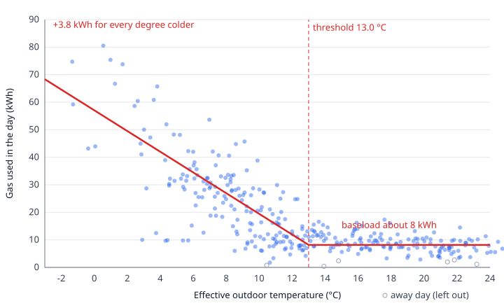

# How the heating model works

This is a plain-language guide to the heating model: what it learns from our gas and weather history, how it projects the gas a day should use, and what it can and cannot tell you. You do not need any statistics. Where an idea has a proper name, there is a "learn more" link.

All the real numbers below come from this household's own data, up to 12 October 2026. They will drift as new data arrives.

> **Status.** The maths described here is built, tested and runs daily. The model is refitted weekly and projects the next seven days, which show as the expected-gas bars on the daily gas panel and drive the cost forecast (section 9). Earlier versions also judged each past day, compared weeks and labelled the model against the thermostat; those were removed on 4 November 2026, after the dashboard review of 2 November took away the panels that showed them (see ADR-0030).

## 1. What this is for, and the picture

The question is simple: **how much gas should a day use, given the weather?**

Plot every day as a dot, with the outdoor temperature across the bottom and the gas used up the side, and the dots make a shape like a hockey stick. On warm days the dots sit on a flat line: the gas that is used whatever the weather (hot water and cooking). As the days get colder than a certain point, the dots climb steadily, because the heating is doing more work.

*Each dot is one day in the 12 months to 12 October 2026. The red line is the fitted model, drawn with the newest baseload; each real day had its own baseload, which is part of why the dots scatter. The hollow dots are away days, left out of the fit.*

The model draws that hockey stick through our own dots. Read off the line, any day's temperature gives the gas we should expect, which is what the seven-day projection uses.

## 2. The one-line idea

On any day, gas used is roughly **a baseload that is always there, plus a slope's worth of extra for every degree the day was colder than a threshold**.

That is the only formula in this guide (later sections repeat it in words). In words: take the temperature below which heating starts, see how far under it the day was, multiply by how much gas each of those degrees costs, and add the always-there gas on top. Everything else is detail on one of those four pieces (baseload, threshold, slope, "how cold the day was").

This family of models is old and well tested. Building scientists have used it since the 1980s to read heating use from utility bills ([the original method, PRISM](https://www.aceee.org/wp-content/uploads/proceedings-1980-2020/1986/SS86_Panel9_Paper_04.pdf)). It is a kind of [segmented regression](https://en.wikipedia.org/wiki/Segmented_regression): a straight line fitted in pieces, with a bend where one piece meets the next. If "regression" is new to you, [linear regression](https://en.wikipedia.org/wiki/Linear_regression) is the gentlest place to start.

## 3. Baseload, and why it moves

The **baseload** is the gas we use on a day warm enough that the heating is off: the hot water and the cooker. On a warm day it is nearly all the gas there is.

The model measures it from the warm days themselves. It averages the gas on warm days over the last 120 days. A "warm day" here means at least a degree above the threshold, and it needs at least eight such days in the window before it will trust the answer.

The baseload is **not a fixed number**, and that matters. In our data it was about 6.1 kWh a day in mid-June 2025 and about 9.2 kWh a day in mid-June 2026. Something in the household changed between the two summers (perhaps more hot water, or a different routine), and a fixed baseload would have blamed the heating for it.

In the depths of winter there are not eight warm days in a 120-day window, so the model cannot measure the baseload then. It joins the last measured value to the next one with a straight line (labelled "interpolated") and, for the newest days, holds the last measured value (labelled "held"). Days before the first measured value hold that first value. Every day therefore has a baseload, and every baseload says how it was obtained: measured, interpolated or held.

## 4. The threshold

The **threshold** is the outdoor temperature below which the heating starts to be needed. Above it, a warmer or colder day makes no difference to gas; below it, every degree matters.

The model finds it by trying every value from 8 to 18 °C in steps of a tenth of a degree and keeping the one whose line fits our dots best. On our latest data the answer is **13.0 °C**.

That is higher than many people expect (heating is often said to start around 15.5 °C). It is the number our own house tells us, which is the point: you can use it for a rule such as "no heating on days warmer than 13".

The measure of "degrees colder than the threshold" has a name: [heating degree days](https://en.wikipedia.org/wiki/Heating_degree_day). A day that averages 3 °C against a 13 °C threshold is 10 degree-days.

## 5. The slope

The **slope** is how much extra gas each degree-day costs. On our latest data it is **about 3.8 kWh per degree-day**. A day 10 degrees under the threshold needs about 38 kWh of heating gas on top of the baseload.

The slope is found by the standard method of drawing the straight line that sits closest to all the dots at once, called [ordinary least squares](https://en.wikipedia.org/wiki/Ordinary_least_squares). It also gives a single score for how well the whole shape fits, called [R-squared](https://en.wikipedia.org/wiki/Coefficient_of_determination). Ours is about **0.69**, meaning temperature explains about 69% of the day-to-day ups and downs in our gas. The other 31% is everything else: sun, wind, how many people were home, how long the shower ran.

## 6. Why yesterday matters

A house is a big lump of brick that heats up and cools down slowly (this is called [thermal mass](https://en.wikipedia.org/wiki/Thermal_mass)). A cold snap that arrived yesterday is still pulling heat out of the walls today. So the model does not use today's temperature on its own. It uses a blend of today's and yesterday's average temperature, which it calls the **effective temperature**.

How much of yesterday goes into the blend is itself learned from the data, within a limit of 80%. On our latest data the best blend is at that limit: about four-fifths yesterday, one-fifth today. That is worth keeping an eye on. If the best answer keeps landing on the limit, it is telling us the house has a longer memory than a two-day blend can express.

The temperatures themselves come from a weather service that publishes an hourly reading for our area: live readings where we have them, and otherwise its archive, which is [reanalysis data](https://en.wikipedia.org/wiki/Reanalysis) (measurements and models blended into a complete record). A day's average is only used when all of its hours are present. A day with a gap is left out, never averaged from what is left.

## 7. Away days

On a holiday the heating is off and the hot water and cooking stop too. Gas for those days falls far below the baseload. If the model treated them as ordinary warm days it would pull its idea of the baseload down, and then every normal day afterwards would look wasteful.

So after a first fit, any day with gas below about a third of its baseload is marked **away**. It is dropped, and the fit is done a second time without it. Across all the history we hold, 33 days are marked away, 27 of them in one stretch of July and August 2025; six fall in the last 12 months and show as hollow dots in the chart in section 1.

A day with a gas reading of exactly zero is a different thing again. It is a missing reading (the meter data did not arrive), and is treated as missing, not as a day of no use.

## 8. What the model cannot tell you

- **Why.** It can say how much gas a day should use. It cannot say why a real day used more or less, whether that was a higher thermostat setting, a boost, a guest, a bath, or a boiler running badly.
- **Heating versus hot water.** It separates them statistically, using warm days to learn the hot-water level. It does not measure either one directly.
- **Weather it does not see.** Wind, sunshine and rain affect a real house, and the model sees only temperature. Cloudy-and-still and sunny-and-gusty days with the same average look identical to it. This is part of the 31% R-squared leaves unexplained.
- **Your house, exactly.** The temperatures are area-wide values for our location, not a thermometer on the wall.
- **The future with certainty.** It projects the next seven days from the weather forecast. A forecast that is two degrees out moves tomorrow's projection by only about 1.5 kWh (four-fifths of the blend is today, which is nearly over, so only a fifth rides on the forecast), but a day later in the week by about 7 to 8 kWh, because then both days in the blend are forecasts.
- **That two years are alike.** Our last two years differ in baseload and in threshold. The model fits the latest 12 months, so it follows the house as it is now, but a sudden change takes weeks to show.

## 9. Reading the dashboard panels

The model feeds one chart (the expected-gas bars) and, through the cost forecast, the billing-period gauge. The heating-cost-per-half-hour chart and the comfort temperature are separate from the model (sections 10 and 11). The charts that showed the model itself (the fitted bend, where the gas went, heating efficiency and the 1 °C setpoint saving) were removed from the dashboard on 2026-11-02, and the code that fed them on 2026-11-04.

- **The next seven days.** Expected gas for each day from the forecast temperature, drawn as lighter bars on the daily gas panel. The cost forecast uses the same numbers.

## 10. What the heating costs, half-hour by half-hour

The model above works in whole days. A separate record answers a different question: how much did the heating cost in each half-hour, however it came on (schedule, manual raise or boost)? A half-hour is the grain of the gas meter, so each row can be compared with a real reading.

- **When the heating is on.** Every two minutes the thermostat reports whether it is calling for heat. A half-hour with 15 such readings, of which 6 say on, has the heating on for 12 minutes. A half-hour with fewer than 12 readings (Hive was down) is left out, never counted as zero.
- **Gas that has arrived.** Octopus's half-hourly gas arrives about a day and a half late. For a half-hour it has covered, the heating's gas is the meter reading less a typical amount for hot water and cooking at that time of day. The household's boiler is a combi, so one burner does both jobs and the meter cannot tell them apart. The typical amount is learned, for each of the 48 half-hours of the day, from half-hours in the last 28 days when the heating was off.
- **Gas that has not.** Until the meter catches up, the half-hour is estimated: minutes on times the boiler's usual draw in kW. That draw is learned from half-hours that have both readings and at least 10 minutes on, once there are 10 of them (it was about 12 kW on the first test evening, and is relearned from then on).
- **The price.** The gas unit rate in force at the start of the half-hour. The standing charge is not included, because the heating does not cause it.
- **The first run.** The first time it runs, the record is rebuilt from every thermostat poll since the first one, so the history starts from the first poll, not from the day of the change.

Example: the heating is on for 12 minutes in a half-hour, the meter says 2.25 kWh, and 0.15 kWh is typical for hot water at that time of day. Heating is 2.1 kWh; at 6 p per kWh that is 12.6 p, drawn as a measured bar. Before the meter arrives the same half-hour might be drawn as an estimated 2.4 kWh (12/60 of an hour at 12 kW), 14.4 p, in a lighter colour.

What this cannot tell you: the thermostat's "on" is demand, not proof the burner was firing the whole time, and the hot-water amount is a typical figure, not a measurement. Both are labelled as estimates.

## 11. The comfort temperature

The comfort temperature is the room temperature the comfort plan holds through the comfort window. It is not learned from the thermostat's setting: it finds the lowest temperature the household is content with by stepping half a degree at a time.

- **Up after a held boost.** A boost pressed inside the comfort window, while the house was holding the comfort temperature and the room was below it by no more than half a degree (16.5 to 16.9 °C at 17.0 °C), means it is too cold. The part of a window after midnight counts for the day it opened on, so a held boost at 00:15 raises the evening before. A boost with the room already at the comfort temperature doesn't count. The comfort temperature goes up 0.5 °C straight away: the rest of the day's window is held warmer from the next hourly plan. One raise a day at most.
- **Down after 3 quiet days.** A quiet day is one on which, inside the comfort window, someone was home for at least 2 hours while the house held the comfort temperature, the heating ran, and nobody pressed boost; held time after midnight, inside the window, counts towards the evening it belongs to. After 3 quiet days since the last step, the next day starts half a degree lower.
- **Everything else counts for nothing.** A day away, a Hive outage (including readings while the thermostat is offline, which only repeat the last value), a dry run, the away override, or a boost while the room was still warming up neither adds to the count of quiet days nor resets it.
- **Never below 16 °C.** This floor is fixed in the code, not a setting: below about 16 °C rooms are linked to damp and health problems. There is no ceiling.
- **Where it settles.** With 3 quiet days per step, it settles where a boost is needed on about one day in five: the cheapest temperature the household mostly puts up with.
- **Counted hours.** A cold room at 03:00 while everyone is asleep is not discomfort. So minutes only count in clock hours in which the heating has been on at least once in the 365 days before the day (from a boost or the schedule).
- **Minutes below comfort.** The minutes in a day when the room was more than half a degree below the comfort temperature in force at the time (below 16.5 °C at 17.0 °C) during a counted hour. The thermostat lets the room swing about 0.2 °C either side of its target, so readings just under the comfort temperature are not discomfort. Minutes while no one is home (by phone presence) don't count: a cold empty house is not discomfort. Neither do readings while Hive cannot reach the thermostat, which only repeat the last value. Days settled before presence was recorded keep every minute.
- **Frozen days.** A day is worked out while it happens and settled once its comfort window has closed (at midnight, or at 00:30 after the Friday and Saturday windows by default). It never changes afterwards.

Example (made-up values): the comfort temperature is 17.0 °C. On Monday, Tuesday and Wednesday someone is home in the evening, the house holds 17.0 °C and nobody boosts: three quiet days, so Thursday starts at 16.5 °C. On Thursday at 19:00, with the room at 16.4 °C, someone presses boost: that is a held boost, so from the next hourly plan the house holds 17.0 °C again, and Friday starts at 17.0 °C with the count back at zero. A boost on Friday morning with the room at 15.8 °C, because the warm-up was late, changes nothing.

Until this rule replaced it (ADR-0040), the comfort temperature was learned as the typical room temperature at which a boost was pressed. Once the house held the room at that temperature, every boost started at or above it, so it could only rise; days settled then keep their learned values.

What this cannot tell you: the thermostat is in one room, and the counted hours are patchy until the heating has been used at most times of day.

## 12. The thermal model

Everything above works in whole days of gas. The thermal model answers a different question: **how does the room's temperature change from one moment to the next?** It is the groundwork for a forecast of the room and for heating advice, both described at the end of this section and drawn on the dashboard.

It is five numbers, learned from the thermostat's own readings and the hourly weather. They are all per hour, whatever the length of the steps they are learned on:

- **Loss.** How much the room falls in an hour for each degree it is warmer than outdoors. On the first six weeks of data it was about 0.02 °C. A room at 17 °C with 7 °C outside loses about 0.2 °C an hour.
- **Heating gain.** How much the room rises per hour of heating: about 1.4 °C. The 45-minute morning slot is worth about 1 °C.
- **Carried gain.** Radiators stay hot after the boiler stops, so some of the rise arrives afterwards: about 0.2 °C per hour of heating on the hourly fit (the figure for the 10 minutes that follow it is not comparable, and not measured yet).
- **Sunshine gain.** How much a bright hour adds: about 0.1 °C in an hour of strong winter sun. Sunshine is used here and nowhere on the dashboard.
- **Constant gain.** A small steady gain from people, cooking and appliances, about 0.06 °C an hour. It is why an unheated house settles a few degrees above outdoors and not at the outdoor temperature.

Example: at 06:00 the room is at 16.0 °C and it is 6 °C outside, before sunrise, and the heating runs for 5 minutes of the next 10. Over 10 minutes, a sixth of an hour: loss is 0.02 times 10 degrees, 0.2 °C an hour, so 0.033 °C. Heating: 5 minutes is a twelfth of an hour at 1.4, 0.117 °C. Constant: 0.06 an hour is 0.01 °C. The model says the room is at about 16.09 °C at 06:10.

**How it is learned.** The model looks at every 10-minute step of the last 60 days for which it has everything: a room reading within 4 minutes after the step's start and after its end, at least 4 of the 5 thermostat polls in the 10 minutes its heating is read from (and in the 10 before), and the weather. Outdoor temperature is drawn in a straight line between the hourly readings. It then finds the five numbers that fit all of those steps best at once ([ordinary least squares](https://en.wikipedia.org/wiki/Ordinary_least_squares), as in section 5). A step with anything missing (Hive was down, a weather gap) is left out, never filled in. It is relearned once a day, and at once the first time after it changes from learning on hours to learning on 10-minute steps. Ten-minute changes are small against a thermostat that reads to 0.1 °C, so the numbers can be noisier than an hourly fit.

**The warm-up delay.** Radiators take time to warm a room: the thermostat calls for heat, and the room starts to respond a while later. The model learns that wait, the warm-up delay, at each refit. It tries every delay from 0 to 40 minutes in steps of 2, each time reading a step's heating from that long earlier, and keeps the delay whose numbers miss the room's changes least.

- **When it is learned.** Only when the 60 days hold at least 10 heating starts (the heating coming on after at least 30 minutes with none). Fewer starts say too little about the wait.
- **When it cannot be.** The last learned delay carries on, so the forecast does not lose it at the start of a season. With none ever learned, the delay is 0 and the dashboard says "not learned yet".
- **A delay near 40 minutes** means the range tried is too short.

Example (made up): the thermostat calls for heat at 05:40 and the room only starts to warm at 05:54, a delay of 14 minutes. Fitted with a 14-minute delay, the model explains the readings better than with any other.

The first refit after this change was the assessment of how long the household's radiators take, which nobody had measured before. On 16 November 2026 it learned a delay of **8 minutes** (source: learned), from **37 heating starts** in the 60 days. That fit used 5,012 complete 10-minute steps, was usable, and its backtest replayed 7 days with a mean miss of 0.24 °C and a worst miss of 0.85 °C. The delay is not at the top of the 0 to 40 minute range, so the range is long enough. The figure and whether it was learned are on the Heating Plan and Room Model panel, and the number of heating starts is stored with each fit.

The same fit gives a heating gain of about 0.68 °C per hour of heating and a carried gain of about 0.75, against about 1.4 and 0.2 on the hourly fit. They are not comparable: the delay and the carried heat now take part of what the hourly model counted as heating, and the carried gain refers to the 10 minutes after the heat arrives. The loss (0.021), sunshine gain (0.31) and constant gain (0.083) are close to the hourly fit's.

**How it is checked.** A model that fits the past is not proof that it predicts. So each time it is relearned it is given a test it has not seen the answers to, called a [backtest](https://en.wikipedia.org/wiki/Backtesting):

- Take each of the last 14 days in turn.
- Learn a model from only the 60 days before that day.
- Start it at the room's temperature at midnight and let it run for the whole day on its own, 10 minutes after 10 minutes, given the weather and the heating that really happened. A model with at least 10 heating starts in its own 60 days uses the delay it would learn; otherwise it uses the delay of the fit being tested.
- Compare what it said with what the thermostat recorded.

The average miss over all those steps, and the worst single miss, are stored with the model. On the first six weeks of data (to 13 November 2026), fitted and replayed by hours, the average was about 0.3 °C and the worst hour about 1 °C, over the 8 days that could be tested; the figures on 10-minute steps are not known yet and may be noisier. A day is only tested when all of its steps are complete, which is stricter than the hourly rule, and the model before it had enough heating to learn from, so early in a heating season several days are skipped.

**When it is not trusted.** Each stored model says whether it is usable, and if not, why:

- under a week of complete steps to learn from (1,008 of them);
- almost no heating in the 60 days (fewer than 30 steps with at least 4 minutes of it), so the heating gain cannot be learned;
- readings too alike to tell the five numbers apart;
- numbers that make no physical sense (a room that warms as it gets colder outside, or heating that cools it);
- fewer than 5 of the 14 days could be tested;
- an average miss above 0.5 °C.

While the newest model is not usable, no new forecast is made. The last forecast lines stay on the dashboard, and the heating plan panel shows why the model is not trusted and how old the forecast is, so a stale line is visibly stale. An older usable model is never brought back in its place.

**The room forecast.** Once an hour the model is run forward from the room's latest reading to the end of tomorrow in 2-minute steps, the thermostat's own reading interval, using the weather forecast, and stored every 10 minutes. It is run twice:

- **Under your Hive schedule as programmed.** The thermostat heats just enough to hold each slot's target, and nothing while Hive's mode is OFF. If the weekly schedule cannot be read, this forecast is left out for that run and the log says so, rather than showing a house with no heating. Slots are followed to the step: a slot beginning at 05:40 heats from 05:40. A slot that starts on an odd minute takes effect from the 2-minute step before it, so one that starts at 06:25 takes over at 06:24.
- **Under the comfort plan.** This is advice only: nothing is ever sent to Hive. The plan holds your comfort temperature (section 11) from 07:30 until 23:00 Monday to Thursday, until 00:30 on Friday night, from 08:30 until 00:30 on Saturday night and until 23:00 on Sunday (the defaults). Each day's window is set in the octopus-app config, and a time on an odd minute is rounded earlier to an even one (07:45 becomes 07:44) with a line in the log, and a window whose different start and end would round to the same mark is refused at startup. The target is held from the step the window opens until the step it closes, and before the opening the plan heats for the shortest whole number of 2-minute steps that has the room at the target at that minute, allowing for the warm-up delay.

With a warm-up delay the forecast treats heat as arriving that long after the thermostat asks for it. Nothing arrives for the first delay of a slot, and heat already asked for keeps arriving for the delay after the slot ends. Gas is counted when the thermostat asks, not when the room responds. The first row is forecast only from the latest reading onwards, and the heating asked for just before it, which has not yet finished arriving, still warms the room in the forecast (its gas is not counted again).

Example: a slot at 19 C from 05:40 to 06:25 and a warm-up delay of 14 minutes. Gas is counted from 05:40. The room line follows its unheated course until 05:54, then climbs. Demand stops at 06:24; heat keeps arriving until 06:38.

Example: the comfort temperature is 19.5 °C, and the delay is 14 minutes. The room at 07:30 needs 42 minutes of arriving heat to reach 19.5 °C. Heat takes 14 minutes to arrive, so the plan switches on 42 plus 14 minutes before 07:30, at 06:34, and holds 19.5 °C from 07:30. With no delay it would have switched on 14 minutes later and the room would reach the target at the same time.

**While Hive is in MANUAL.** If the newest poll is MANUAL (a temperature set by hand, or the Away Override, held until changed) with no boost running, this forecast holds that temperature for the whole forecast instead of following the programmed slots. A boost running, or SCHEDULE mode, follows the slots as before. Future absences are not predicted, and a Day-Ahead Forecast frozen while MANUAL keeps that assumption.

Each 10-minute row is stored with its heating minutes and cost (the minutes times the boiler's learned kW, times the gas unit rate of section 10, read once for each hour). Rows carry their own start and end, so the panels judge a day complete by the minutes its rows cover, never by counting rows. The dashboard draws the two room lines dotted on the temperature chart, and a separate panel shows the minutes and cost of each, the backtest error, whether the model is trusted and the warm-up delay.

**The schedule table.** One table on the dashboard lists today's heating slots, each as `start - end | target`, and changes day at midnight London time. The first column is the Hive schedule as programmed: every slot of the day, each running to the next one's start, with the previous day's last target carried over until the day's first slot and equal neighbours merged. The second is the comfort plan: one slot from when the plan switches heating on (including the pre-heat) to when the comfort window closes, at the comfort temperature. The plan is recomputed every hour, but once its start time has passed the start is kept (the live forecast no longer holds that time), so the row does not jump during the morning. A slot shows on the day its window opens, so just after midnight on a Saturday the table shows Saturday's slot, not the end of Friday's slot that Hive holds until 00:30. The last row of each column is the estimated gas cost from now to midnight, the sum of that scenario's live rows at the unit rates of section 10, shown only when its rows cover every minute of it. A column is empty when the weekly schedule cannot be read (current) or there is no comfort temperature (plan). As with the forecast, a manually held temperature is not shown.

**Day-ahead lines.** The forecast for tomorrow is rewritten every hour until midnight and then frozen, and only written when it covers every minute of tomorrow. Past days therefore keep the forecast as it stood when the day began, which can be compared with what the room really did. Today's live forecast is the freshest, tomorrow's frozen copy is the honest one.

What this cannot tell you: it describes one room, the one with the thermostat. It has seen only mild weather so far (nothing colder than about 1 °C outdoors), so its numbers will move as winter arrives, which is why it is relearned and retested daily. It knows nothing about open windows, guests or a door left open, which show up as misses. And the backtest is given the heating that really happened, so it tests the house model, not anyone's ability to guess when the heating will be on.

## 13. Glossary and further reading

**Away day.** A day with gas under about a third of the baseload, treated as a holiday and left out.

**Backtest.** A replay of each of the last 14 days by a thermal model that learned only from the days before it, to measure how far its predictions miss.

**Baseload.** Gas used whatever the weather: hot water and cooking. Measured from warm days over the last 120 days.

**Comfort temperature.** The room temperature the comfort plan holds: half a degree up after a held boost, half a degree down after 3 quiet days, never below 16 °C.

**Comfort plan.** The least heating that keeps the room at the comfort temperature through the comfort window, including the pre-heat before it. Advice only.

**Comfort window.** The hours of a day the comfort plan keeps comfortable: 07:30 to 23:00 Monday to Thursday, 07:30 to 00:30 on Friday, 08:30 to 00:30 on Saturday and 08:30 to 23:00 on Sunday by default, each day set in the config. A window that ends after midnight belongs to the day it opened on, and the part after midnight counts as that evening's evidence (section 11).

**Counted hour.** A clock hour in which the heating has been on in the last 365 days; only these count towards minutes below comfort.

**Day-ahead forecast.** The room forecast for a day as it stood when that day began, never changed afterwards.

**Degree-day.** One degree of difference below the threshold, for one day. A 3 °C day against a 13 °C threshold is 10 degree-days.

**Effective temperature.** The blend of today's and yesterday's average temperature that the model treats as "how cold it was".

**Expected gas.** The baseload plus the slope times the degree-days.

**Heating day.** A day on which the heating was on at least once. Old boosts fade by heating days, not calendar days.

**Heating start.** The heating coming on after at least 30 minutes with none. A warm-up delay is learned only from 60 days with at least 10 of them.

**Room forecast.** The predicted room temperature in 2-minute steps to the end of tomorrow, stored every 10 minutes and made twice: under the Hive schedule as programmed and under the comfort plan.

**Slope.** The extra gas each degree-day costs, in kWh.

**Thermal model.** Five learned numbers that say how the thermostat's room warms and cools, learned on 10-minute steps and given per hour.

**Warm-up delay.** The time between the thermostat calling for heat and the room responding, learned at each daily refit from 0 to 40 minutes.

**Threshold.** The temperature below which heating starts to be needed.

### Learn more

- [Heating degree day](https://en.wikipedia.org/wiki/Heating_degree_day)
- [Linear regression](https://en.wikipedia.org/wiki/Linear_regression)
- [Ordinary least squares](https://en.wikipedia.org/wiki/Ordinary_least_squares)
- [Segmented regression](https://en.wikipedia.org/wiki/Segmented_regression)
- [Coefficient of determination (R-squared)](https://en.wikipedia.org/wiki/Coefficient_of_determination)
- [Thermal mass](https://en.wikipedia.org/wiki/Thermal_mass)
- [Backtesting](https://en.wikipedia.org/wiki/Backtesting)
- [Reanalysis](https://en.wikipedia.org/wiki/Reanalysis)
- [PRISM, the original three-parameter heating model](https://www.aceee.org/wp-content/uploads/proceedings-1980-2020/1986/SS86_Panel9_Paper_04.pdf)
